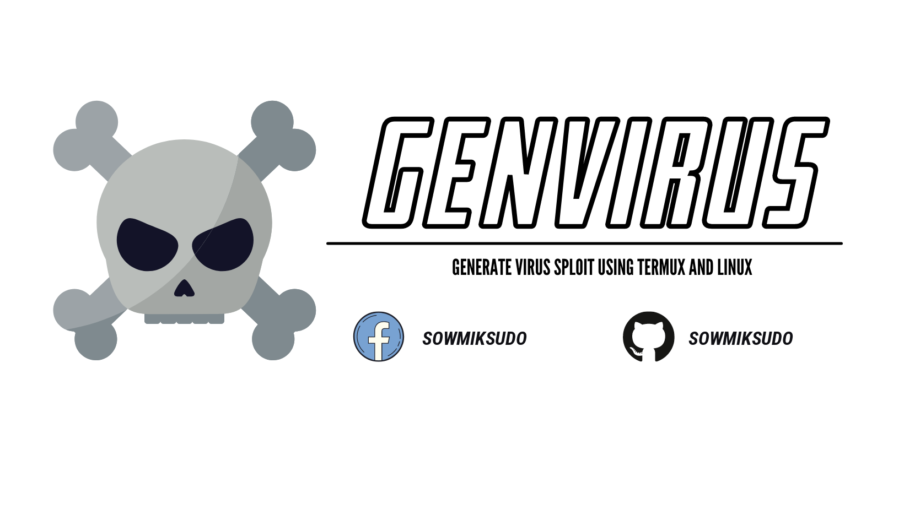
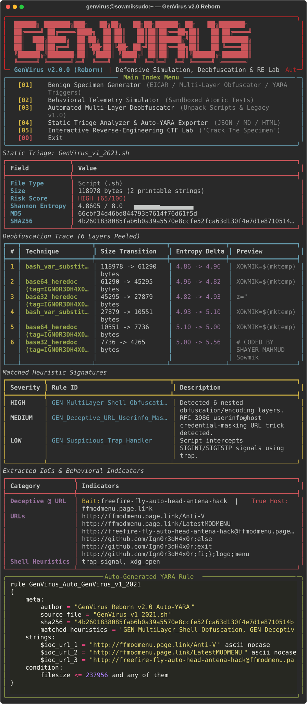
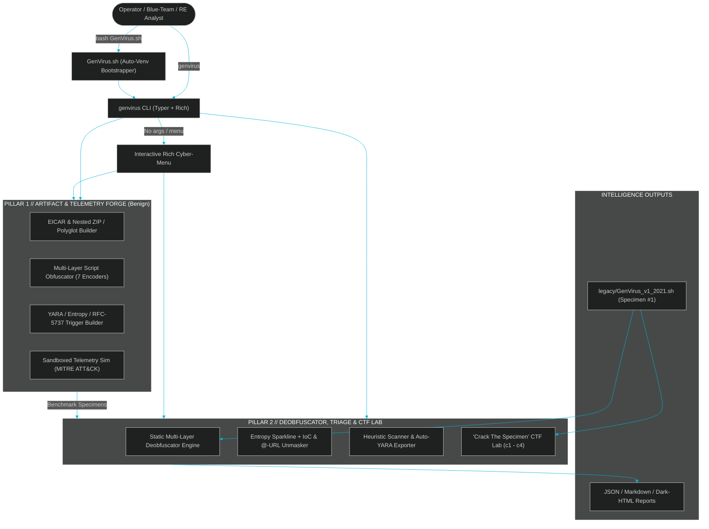

<p align="center">
  <a href="https://github.com/sowmiksudo/GenVirus">
    
  </a>
</p>

<p align="center">
  
  
  
  
</p>

<p align="center">
  <a href="https://github.com/sowmiksudo"></a>
  <a href="https://github.com/sowmiksudo/followers"></a>
  <a href="https://github.com/sowmiksudo/GenVirus/stargazers"></a>
  <a href="https://github.com/sowmiksudo/GenVirus/network/members"></a>
  <a href="LICENSE"></a>
</p>

<div align="center">

```text
╔══════════════════════════════════════════════════════════════════════════════════╗
║   ██████╗ ███████╗███╗   ██╗██╗   ██╗██╗██████╗ ██╗   ██╗███████╗                ║
║  ██╔════╝ ██╔════╝████╗  ██║██║   ██║██║██╔══██╗██║   ██║██╔════╝                ║
║  ██║  ███╗█████╗  ██╔██╗ ██║██║   ██║██║██████╔╝██║   ██║███████╗   v2.0         ║
║  ██║   ██║██╔══╝  ██║╚██╗██║╚██╗ ██╔╝██║██╔══██╗██║   ██║╚════██║   REBORN       ║
║  ╚██████╔╝███████╗██║ ╚████║ ╚████╔╝ ██║██║  ██║╚██████╔╝███████║                ║
║   ╚═════╝ ╚══════╝╚═╝  ╚═══╝  ╚═══╝  ╚═╝╚═╝  ╚═╝ ╚═════╝ ╚══════╝                ║
║  [ BENIGN MALWARE SIMULATOR  //  MULTI-LAYER DEOBFUSCATOR  //  CTF LAB ]         ║
╚══════════════════════════════════════════════════════════════════════════════════╝
```

**Dual-Mode Purple-Team & Malware Reverse-Engineering Arsenal — Safely Forge Benign Detection Specimens, Peel 6+ Obfuscation Layers Statically, Auto-Export YARA Rules & Crack Live Specimens.**

</div>

---

## `// SYSTEM_LOG: 2021 -> 2026 REBORN`

```console
[root@sowmiksudo-lab:~]# cat /var/log/genvirus_origin.log
> [2021-INIT]   GenVirus v1.0 spawned as a 118 KB Termux bash script wrapped in 6 layers
                (variable-chunk substitution + Base64 + Base32). Somehow hit 400+ stars.
> [2026-AUDIT]  Status: Relic preserved intact at legacy/GenVirus_v1_2021.sh (Specimen #1).
> [2026-REBORN] Rebuilt from the ground up in Python 3 (Rich + Typer) as an ethical
                Purple-Team Simulation & Reverse-Engineering Workbench:
                [+] Forge safe EICAR/YARA/obfuscation benchmarks for AV & EDR validation
                [+] Peel arbitrary encoding chains statically WITHOUT ever executing eval
                [+] Unmask RFC-3986 userinfo@host bait URLs & emit Shannon entropy heatmaps
                [+] Auto-generate ready-to-deploy .yar signatures + JSON/MD/HTML dossiers
```

---

## `// LIVE TERMINAL HUD`

<p align="center">
  
</p>

<details>
<summary><b>Click to inspect raw ASCII trace of GenVirus unpacking its own 2021 v1.0 artifact</b></summary>

```text
╭─ Deobfuscation Trace (6 Layers Peeled) ───────────────────────────────────────────╮
│  # │ Technique                  │ Size Transition     │ Entropy Delta             │
│  1 │ bash_var_substitution      │ 118978 -> 61290 B   │ 4.86 -> 4.98              │
│  2 │ base64_heredoc             │ 61290  -> 45295 B   │ 4.98 -> 5.98              │
│  3 │ base32_heredoc             │ 45295  -> 27879 B   │ 5.98 -> 5.01              │
│  4 │ bash_var_substitution      │ 27879  -> 10551 B   │ 5.01 -> 4.95              │
│  5 │ base64_heredoc             │ 10551  -> 7736  B   │ 4.95 -> 6.01              │
│  6 │ base32_heredoc             │ 7736   -> 4265  B   │ 6.01 -> 5.29              │
╰───────────────────────────────────────────────────────────────────────────────────╯
[!] Shannon Entropy Profile : 4.8605 / 8.0   ▅▅▅▅▅▅▅▄▄▄▄▄▄▄▄▄
[!] RFC-3986 Masked URL     : Bait='freefire-fly-auto-head-antena-hack' -> True Host='ffmodmenu.page.link'
```

</details>

---

## `// SYSTEM ARCHITECTURE`



---

## `// TACTICAL ARSENAL MATRIX`

### Pillar 1 — Benign Artifact & Telemetry Forge (Purple-Team / AV & EDR Validation)

| Module | Subcommand | Capabilities & MITRE / RFC Standards |
| :--- | :--- | :--- |
| **EICAR Forge** | `genvirus generate eicar` | Runtime-assembled 68-byte standard EICAR signature wrapped in `raw`, `base64`, `hex`, `polyglot` `.sh`, or recursive `zip` archives (`--depth 1..10`) to test AV recursion limits. |
| **Obfuscation Benchmark** | `genvirus generate obfuscate` | Wraps benign payloads in configurable pipelines (`base64`, `base32`, `hex`, `rot13`, `zlib`, `xor`, and v1.0-style `bash_vars` chunk substitution) via `light`, `legacy-v1`, or `deep` presets. |
| **Detection Triggers** | `genvirus generate trigger` | Builds 100% inert files with `pe-mock` (`MZ` + API markers), `high-entropy` (`>7.5` bits/byte packed blocks), and `ioc-strings` using safe **RFC 5737 / RFC 2606** indicators + JSON manifest. |
| **Telemetry Sandbox** | `genvirus simulate` | Executes harmless Atomic-style checks (`T1059.004`, `T1027`, `T1547` mock `.desktop`, `T1071.004` `example.com` DNS, `T1082`) inside an isolated sandbox with `--dry-run`, JSONL logs & auto-cleanup. |

### Pillar 2 — Automated Deobfuscator, Static Triage, Auto-YARA & CTF Lab

| Module | Subcommand | Capabilities & Detection Coverage |
| :--- | :--- | :--- |
| **Static Deobfuscator** | `genvirus deobfuscate` | Safely peels up to 25 nested layers (`bash_var_substitution`, `base64`/`base32` heredocs, `zlib`, `rot13`, `xor`, `hex`) **purely in memory** without executing `eval` or `source`. |
| **Static Triage & IoCs** | `genvirus analyze` | Computes MD5/SHA1/SHA256, 16-chunk Shannon entropy sparklines (`▁▂▃▄▅▆▇█`), suspicious shell patterns (`eval`, `mktemp`+`source`, `trap`, `curl \| sh`), and unmasks **RFC 3986 `userinfo@host`** bait links. |
| **Auto-YARA & Reports** | `genvirus analyze --yara-out` | Fires built-in heuristic rules (`GEN_MultiLayer_Shell_Obfuscation`, `GEN_Deceptive_URL_Userinfo_Masking`, etc.), exports a ready-to-use `.yar` rule, and renders **JSON / Markdown / Dark-HTML** reports. |
| **CTF Lab** | `genvirus lab` | *"Crack The Specimen"* — 4 progressive hands-on reverse-engineering missions (`c1`–`c4`), starting with the live 2021 `legacy/GenVirus_v1_2021.sh` time capsule. |

---

## `// MULTI-PLATFORM DEPLOYMENT`

### Option A: Zero-Friction One-Liner (Kali / Parrot / Ubuntu / macOS / Termux)
```bash
git clone https://github.com/sowmiksudo/GenVirus.git && cd GenVirus && bash GenVirus.sh
```
> Running `bash GenVirus.sh` with no arguments automatically provisions an isolated `.venv` (if needed) and boots the **Interactive Rich Cyber-Menu**. Pass any CLI flag directly (e.g., `bash GenVirus.sh analyze legacy/GenVirus_v1_2021.sh`) to run headlessly.

### Option B: Editable Python Package Install
```bash
git clone https://github.com/sowmiksudo/GenVirus.git
cd GenVirus
pip install -e .
genvirus --help
```

---

## `// COMMAND PLAYBOOK`

```bash
# [1] Unpack all 6 layers of the original 2021 script statically (zero execution)
genvirus deobfuscate legacy/GenVirus_v1_2021.sh --output artifacts_out/v1_unpacked.sh

# [2] Full static triage + Auto-YARA rule + JSON / Markdown / Dark-HTML reports
genvirus analyze legacy/GenVirus_v1_2021.sh \
  --yara-out artifacts_out/genvirus_v1.yar \
  --json artifacts_out/report.json \
  --markdown artifacts_out/report.md \
  --html artifacts_out/report.html

# [3] Forge a 4-layer nested EICAR ZIP archive to test AV scanner recursion depth
genvirus generate eicar --variant zip --depth 4 --output artifacts_out

# [4] Forge a 6-layer obfuscated benign benchmark script (rot13 -> hex -> zlib -> base32 -> base64 -> bash_vars)
genvirus generate obfuscate --preset deep --output artifacts_out/deep_bench.sh

# [5] Forge inert YARA/Sigma trigger artifacts (PE-mock + High-Entropy + RFC-5737 IoCs)
genvirus generate trigger --profile all --output artifacts_out

# [6] Run Atomic-style behavioral telemetry simulation (dry-run or live local sandbox)
genvirus simulate --technique all --dry-run
```

<details>
<summary><b>Sample Auto-Generated YARA Signature (`genvirus analyze --yara-out`)</b></summary>

```yara
rule GenVirus_Auto_GenVirus_v1_2021
{
    meta:
        author = "GenVirus Reborn v2.0 Auto-YARA"
        source_file = "GenVirus_v1_2021.sh"
        sha256 = "4b2601838085fab6b0a39a5570e8ccfe52fca63d130f4e7d1e8710514b..."
        matched_heuristics = "GEN_MultiLayer_Shell_Obfuscation, GEN_Deceptive_URL_Userinfo_Masking, GEN_Suspicious_Trap_Handler"
    strings:
        $ioc_url_1 = "http://ffmodmenu.page.link/Anti-V" ascii nocase
        $ioc_url_2 = "http://ffmodmenu.page.link/LatestMODMENU" ascii nocase
        $ioc_url_3 = "http://freefire-fly-auto-head-antena-hack@ffmodmenu.page.link/LatestMODMENU" ascii nocase
    condition:
        filesize <= 237956 and any of them
}
```

</details>

---

## `// "CRACK THE SPECIMEN" CTF LAB DOSSIER`

```bash
genvirus lab list                        # Provision dynamic specimens & list challenges
genvirus lab verify c1 --answer <FLAG>   # Submit & validate your solution
```

| ID | Mission Codename | Difficulty | Target Specimen | Primary Skill Tested |
| :---: | :--- | :---: | :--- | :--- |
| **`c1`** | **The 2021 Time Capsule** | `Beginner` | [`legacy/GenVirus_v1_2021.sh`](legacy/GenVirus_v1_2021.sh) | Unpack 6 layers & expose the true host behind an `@` masked phishing URL |
| **`c2`** | **Matryoshka Beacon** | `Intermediate` | `artifacts_out/lab/c2_matryoshka.sh` | Peel `base64 -> base32 -> hex -> zlib` layers to recover the hidden `FLAG{...}` |
| **`c3`** | **Entropy & IoC Hunt** | `Intermediate` | `artifacts_out/lab/trigger_ioc_strings.txt` | Triage RFC-5737 C2 indicators & export matching YARA signatures |
| **`c4`** | **Ghost in the Sandbox** | `Advanced` | `artifacts_out/telemetry_events_*.jsonl` | Correlate sandboxed Atomic telemetry to MITRE ATT&CK Technique IDs |

---

## `// VERIFICATION & CI`

```bash
pip install -e ".[dev]"
bash -n GenVirus.sh
pytest -v --tb=short
```

---

> [!IMPORTANT]
> **RULES OF ENGAGEMENT & ETHICAL SAFETY POLICY**
>
> **GenVirus v2.0 Reborn** is built exclusively for **defensive security engineering, EDR/AV validation, detection rule authoring, and reverse-engineering education**:
> - **Zero Destructive Payloads**: Never generates real malware, exploits, worms, or system-wide persistence.
> - **RFC-Compliant Indicators**: All simulated IoCs strictly use reserved documentation blocks (**RFC 5737** `192.0.2.0/24`, `198.51.100.0/24`, `203.0.113.0/24` & **RFC 2606** `.example.com`, `.invalid`).
> - **100% Static Deobfuscation**: The unpacking engine parses AST/string layers in memory and **never** executes untrusted `eval` or `source` blocks.

<p align="center">
  <sub>Rebuilt with defensive precision by <a href="https://github.com/sowmiksudo"><b>Shayer Mahmud Sowmik (@sowmiksudo)</b></a> &bull; Original 2021 heritage archived in <a href="legacy/GenVirus_v1_2021.sh"><code>legacy/GenVirus_v1_2021.sh</code></a></sub>
</p>
